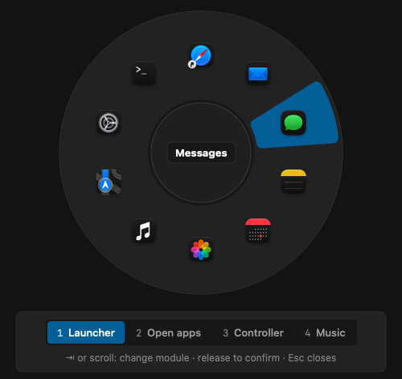

# mPIE

A personal pie menu for macOS: launch, switch and control your apps and your music from a ring that opens under the pointer.

## About

- **Authors:** Starbudweiser & Claude Code (Anthropic).
- **License:** MIT. © 2026 Starbudweiser.
- Provided as is, without warranty. Part of the **DESKTOP MAC TOOLKIT**.
- Inspired by [Pieoneer](https://appahead.studio/apps/pieoneer/) by App ahead, with no affiliation with its authors. No asset or code from the original is used.
- In the app: menu bar icon → **About mPIE**.



## Modules

- **Launcher**: apps, folders and files (up to 16), ordered clockwise from the top.
- **Open apps**: jump to any running app, most recently used first; exclude the ones you never want.
- **Controller**: sends the shortcuts of the frontmost app (Finder, Safari, Chrome, Mail, Notes, Terminal, DaVinci Resolve, Blender, Xcode, VS Code, or your own set).
- **Music**: play/pause, next, previous, shuffle, repeat for Apple Music and Spotify, with title and artwork.

## Presets

Settings → **Presets** fills the launcher from ready-made sets (macOS essentials, video, development, office, design, communication, a folder of your own apps) keeping only the apps installed on your Mac, and sets the way the menu opens (keyboard and mouse, keyboard only, mouse only, tap then click).

## Opening the menu

Hold ⌥ Space (or ⌥ + middle button) and release over a slice. A quick press keeps the menu open; click a slice to confirm. ⇥ or the scroll wheel changes module, 1–4 jump to a module, Esc closes.

## Build

```bash
./build_app.sh            # builds and installs mPIE.app in ~/Applications/Applications Personnelles
DEV=1 ./build_app.sh      # builds "mPIE DEV.app" (separate bundle id and data), not installed
swift test
```

macOS 14 or later. The Controller needs the Accessibility permission; the music remote asks for Automation the first time.

## Support / Soutenir

This app is free. If it is useful to you, you can support the project (optional, no reward expected): [GitHub Sponsors](https://github.com/sponsors/starbudweiser).

Cette appli est gratuite. Si elle vous est utile, vous pouvez soutenir le projet (facultatif, sans contrepartie) : [GitHub Sponsors](https://github.com/sponsors/starbudweiser).
